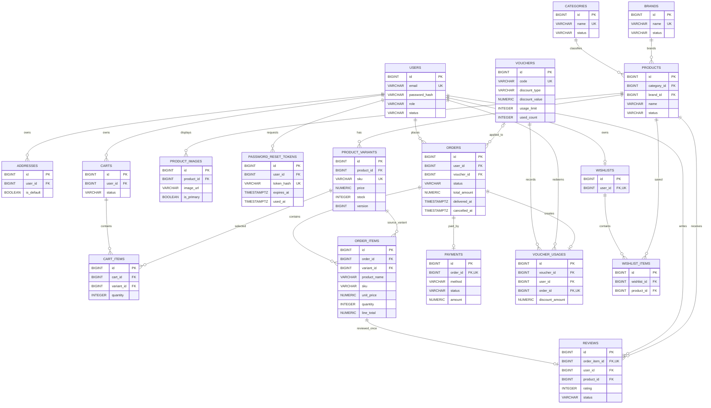
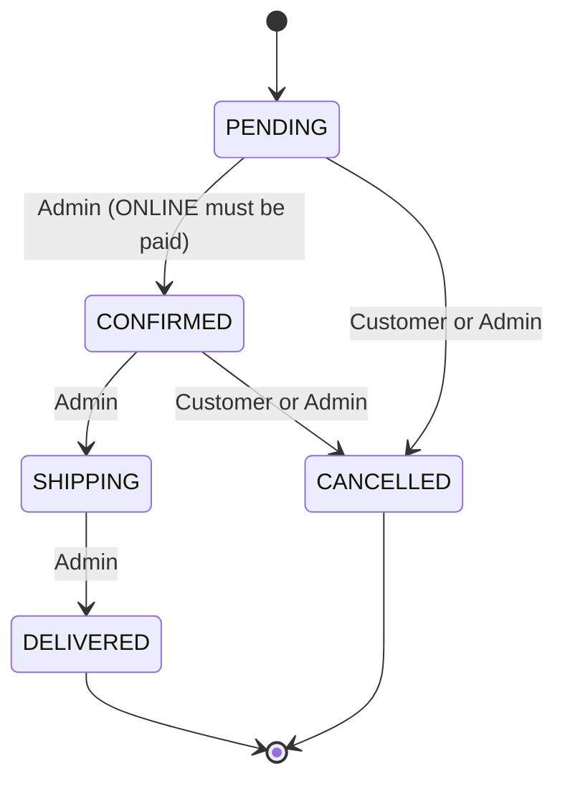
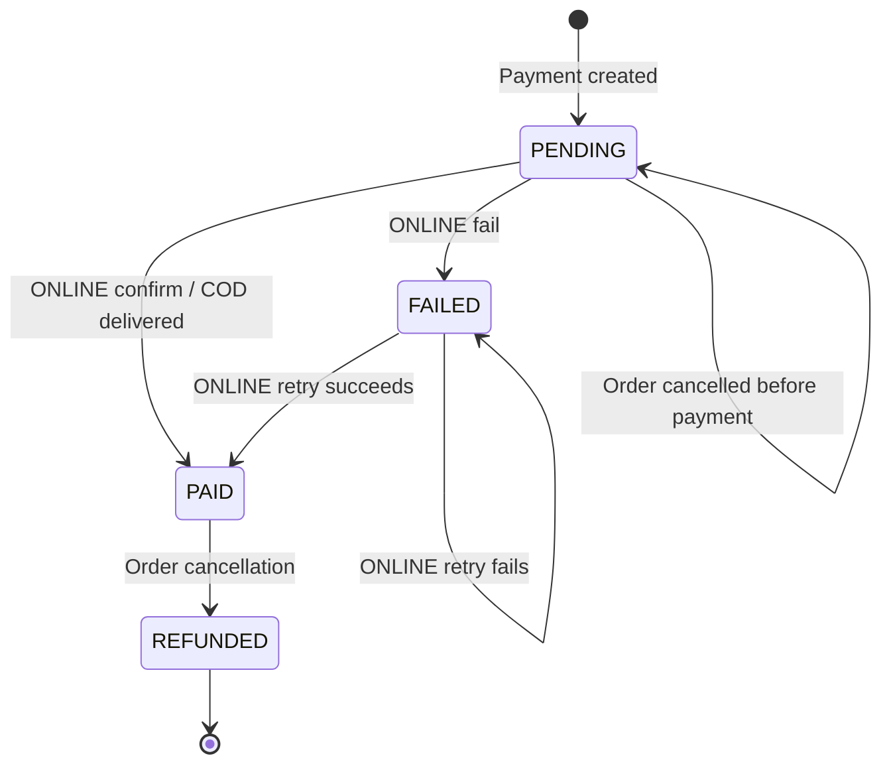

# Database and ERD

This document describes the PostgreSQL schema created by the repository's Flyway migrations.
The source of truth is `backend/src/main/resources/db/migration/V1__baseline.sql` through
`V9__wishlist_schema.sql`; the optional demo profile also applies
`backend/src/main/resources/db/seed/V100__demo_seed.sql`. `NUMERIC(14,2)` stores VND amounts,
and all timestamps use `TIMESTAMPTZ`.

## 1. Entity relationship diagram



The ERD expresses allowed database cardinalities. For example, the application creates one
payment and at least one item per order, but the foreign keys alone allow an order to have
zero payment rows or zero item rows. `CARTS` can contain multiple historical `CHECKED_OUT`
carts per user; only one `ACTIVE` cart is permitted.

## 2. Data dictionary

`NOT NULL` means the column is required. `Generated` means PostgreSQL `BIGSERIAL` allocates
the identifier. Unless otherwise stated, columns have no default. The shared `created_at`
and `updated_at` columns are `TIMESTAMPTZ NOT NULL DEFAULT CURRENT_TIMESTAMP`.

### `users` (V2)

| Column | Type | Null | Default | Description |
|---|---|---:|---|---|
| `id` | BIGSERIAL | No | Generated | User primary key. |
| `email` | VARCHAR(255) | No | — | Unique login email. |
| `password_hash` | VARCHAR(255) | No | — | BCrypt password hash. |
| `full_name` | VARCHAR(150) | No | — | Account name. |
| `phone` | VARCHAR(30) | Yes | — | Optional account phone. |
| `role` | VARCHAR(20) | No | `CUSTOMER` | `CUSTOMER` or `ADMIN`. |
| `status` | VARCHAR(20) | No | `ACTIVE` | `ACTIVE` or `DISABLED`. |
| `created_at`, `updated_at` | TIMESTAMPTZ | No | Current timestamp | Audit timestamps. |

### `addresses` (V2)

| Column | Type | Null | Default | Description |
|---|---|---:|---|---|
| `id` | BIGSERIAL | No | Generated | Address primary key. |
| `user_id` | BIGINT | No | — | Owner; deleting a user cascades. |
| `receiver_name` | VARCHAR(150) | No | — | Recipient name. |
| `phone` | VARCHAR(30) | No | — | Recipient phone. |
| `address_line` | VARCHAR(255) | No | — | Street/address line. |
| `ward` | VARCHAR(120) | Yes | — | Ward. |
| `district` | VARCHAR(120) | Yes | — | District. |
| `city` | VARCHAR(120) | No | — | City/province. |
| `is_default` | BOOLEAN | No | `FALSE` | Default address indicator. |
| `created_at`, `updated_at` | TIMESTAMPTZ | No | Current timestamp | Audit timestamps. |

### `categories` and `brands` (V3)

| Table | Column | Type | Null | Default | Description |
|---|---|---|---:|---|---|
| `categories` | `id` | BIGSERIAL | No | Generated | Primary key. |
| `categories` | `name` | VARCHAR(120) | No | — | Unique category name. |
| `categories` | `status` | VARCHAR(20) | No | `ACTIVE` | `ACTIVE` or `INACTIVE`. |
| `brands` | `id` | BIGSERIAL | No | Generated | Primary key. |
| `brands` | `name` | VARCHAR(120) | No | — | Unique brand name. |
| `brands` | `status` | VARCHAR(20) | No | `ACTIVE` | `ACTIVE` or `INACTIVE`. |
| Both | `created_at`, `updated_at` | TIMESTAMPTZ | No | Current timestamp | Audit timestamps. |

### `products` (V3)

| Column | Type | Null | Default | Description |
|---|---|---:|---|---|
| `id` | BIGSERIAL | No | Generated | Product primary key. |
| `category_id` | BIGINT | No | — | Category; delete is restricted while referenced. |
| `brand_id` | BIGINT | No | — | Brand; delete is restricted while referenced. |
| `name` | VARCHAR(200) | No | — | Product name. |
| `description` | TEXT | Yes | — | Product description. |
| `status` | VARCHAR(20) | No | `ACTIVE` | `ACTIVE` or `INACTIVE`. |
| `created_at`, `updated_at` | TIMESTAMPTZ | No | Current timestamp | Audit timestamps. |

### `product_variants` (V3)

| Column | Type | Null | Default | Description |
|---|---|---:|---|---|
| `id` | BIGSERIAL | No | Generated | Variant primary key. |
| `product_id` | BIGINT | No | — | Parent product; deleting product cascades. |
| `sku` | VARCHAR(100) | No | — | Globally unique stock-keeping unit. |
| `price` | NUMERIC(14,2) | No | — | Unit selling price. |
| `stock` | INTEGER | No | `0` | Available inventory; cannot be negative. |
| `status` | VARCHAR(20) | No | `ACTIVE` | `ACTIVE` or `INACTIVE`. |
| `version` | BIGINT | No | `0` | JPA optimistic-lock version (`@Version`). |
| `created_at`, `updated_at` | TIMESTAMPTZ | No | Current timestamp | Audit timestamps. |

### `product_images` (V3)

| Column | Type | Null | Default | Description |
|---|---|---:|---|---|
| `id` | BIGSERIAL | No | Generated | Image primary key. |
| `product_id` | BIGINT | No | — | Parent product; deleting product cascades. |
| `image_url` | VARCHAR(1000) | No | — | Image location. |
| `is_primary` | BOOLEAN | No | `FALSE` | Whether this is the product's primary image. |
| `sort_order` | INTEGER | No | `0` | Non-negative display order. |
| `created_at`, `updated_at` | TIMESTAMPTZ | No | Current timestamp | Audit timestamps. |

### `password_reset_tokens` (V4)

| Column | Type | Null | Default | Description |
|---|---|---:|---|---|
| `id` | BIGSERIAL | No | Generated | Token primary key. |
| `user_id` | BIGINT | No | — | Owner; deleting a user cascades. |
| `token_hash` | VARCHAR(64) | No | — | Unique stored token hash (not the raw token). |
| `expires_at` | TIMESTAMPTZ | No | — | Expiration time. |
| `used_at` | TIMESTAMPTZ | Yes | — | Consumption time; null while unused. |
| `created_at`, `updated_at` | TIMESTAMPTZ | No | Current timestamp | Audit timestamps. |

### `carts` (V5)

| Column | Type | Null | Default | Description |
|---|---|---:|---|---|
| `id` | BIGSERIAL | No | Generated | Cart primary key. |
| `user_id` | BIGINT | No | — | Owner; deleting a user cascades. |
| `status` | VARCHAR(20) | No | `ACTIVE` | `ACTIVE` or `CHECKED_OUT`. |
| `created_at`, `updated_at` | TIMESTAMPTZ | No | Current timestamp | Audit timestamps. |

### `cart_items` (V5)

| Column | Type | Null | Default | Description |
|---|---|---:|---|---|
| `id` | BIGSERIAL | No | Generated | Cart item primary key. |
| `cart_id` | BIGINT | No | — | Parent cart; deleting cart cascades. |
| `variant_id` | BIGINT | No | — | Variant; deleting variant cascades. |
| `quantity` | INTEGER | No | — | Positive requested quantity. |
| `created_at`, `updated_at` | TIMESTAMPTZ | No | Current timestamp | Audit timestamps. |

### `vouchers` (V6)

| Column | Type | Null | Default | Description |
|---|---|---:|---|---|
| `id` | BIGSERIAL | No | Generated | Voucher primary key. |
| `code` | VARCHAR(50) | No | — | Unique voucher code. |
| `description` | VARCHAR(255) | Yes | — | Optional description. |
| `discount_type` | VARCHAR(20) | No | — | `FIXED` or `PERCENTAGE`. |
| `discount_value` | NUMERIC(14,2) | No | — | Positive fixed amount or percentage (at most 100). |
| `min_order_value` | NUMERIC(14,2) | No | `0` | Minimum eligible subtotal. |
| `max_discount` | NUMERIC(14,2) | Yes | — | Optional positive percentage-discount cap. |
| `usage_limit` | INTEGER | Yes | — | Optional positive maximum usage count. |
| `used_count` | INTEGER | No | `0` | Non-negative count, no greater than limit when set. |
| `start_date`, `end_date` | TIMESTAMPTZ | No | — | Validity period; start must precede end. |
| `status` | VARCHAR(20) | No | `ACTIVE` | `ACTIVE` or `INACTIVE`. |
| `created_at`, `updated_at` | TIMESTAMPTZ | No | Current timestamp | Audit timestamps. |

### `orders` (V7)

| Column | Type | Null | Default | Description |
|---|---|---:|---|---|
| `id` | BIGSERIAL | No | Generated | Order primary key. |
| `user_id` | BIGINT | No | — | Customer; deletion is restricted while orders exist. |
| `status` | VARCHAR(20) | No | `PENDING` | Order lifecycle state. |
| `receiver_name`, `receiver_phone` | VARCHAR(150), VARCHAR(30) | No | — | Recipient snapshot at checkout. |
| `shipping_address_line` | VARCHAR(255) | No | — | Address snapshot at checkout. |
| `shipping_ward`, `shipping_district` | VARCHAR(120) | Yes | — | Optional address snapshots. |
| `shipping_city` | VARCHAR(120) | No | — | City/province snapshot. |
| `subtotal` | NUMERIC(14,2) | No | — | Sum of item line totals before shipping/discount. |
| `shipping_fee` | NUMERIC(14,2) | No | `0` | Shipping fee snapshot. |
| `discount_amount` | NUMERIC(14,2) | No | `0` | Discount snapshot; cannot exceed subtotal. |
| `total_amount` | NUMERIC(14,2) | No | — | Must equal subtotal + shipping fee - discount. |
| `voucher_id` | BIGINT | Yes | — | Applied voucher; deletion is restricted while referenced. |
| `voucher_code` | VARCHAR(50) | Yes | — | Voucher code snapshot. |
| `note` | VARCHAR(500) | Yes | — | Optional customer note. |
| `delivered_at`, `cancelled_at` | TIMESTAMPTZ | Yes | — | Lifecycle timestamps maintained by application logic. |
| `created_at`, `updated_at` | TIMESTAMPTZ | No | Current timestamp | Audit timestamps. |

### `order_items` (V7)

| Column | Type | Null | Default | Description |
|---|---|---:|---|---|
| `id` | BIGSERIAL | No | Generated | Order item primary key. |
| `order_id` | BIGINT | No | — | Parent order; deleting order cascades. |
| `variant_id` | BIGINT | No | — | Source variant; deletion is restricted while referenced. |
| `product_name` | VARCHAR(200) | No | — | Product-name snapshot at checkout. |
| `sku` | VARCHAR(100) | No | — | SKU snapshot at checkout. |
| `unit_price` | NUMERIC(14,2) | No | — | Unit-price snapshot. |
| `quantity` | INTEGER | No | — | Positive purchased quantity. |
| `line_total` | NUMERIC(14,2) | No | — | Must equal unit price × quantity. |
| `created_at`, `updated_at` | TIMESTAMPTZ | No | Current timestamp | Audit timestamps. |

### `payments` (V7)

| Column | Type | Null | Default | Description |
|---|---|---:|---|---|
| `id` | BIGSERIAL | No | Generated | Payment primary key. |
| `order_id` | BIGINT | No | — | Unique order; deleting order cascades. |
| `method` | VARCHAR(20) | No | — | `COD` or `ONLINE`. |
| `status` | VARCHAR(20) | No | `PENDING` | `PENDING`, `PAID`, `FAILED`, or `REFUNDED`. |
| `amount` | NUMERIC(14,2) | No | — | Non-negative payment amount. |
| `transaction_ref` | VARCHAR(100) | Yes | — | Optional simulated/provider transaction reference. |
| `paid_at` | TIMESTAMPTZ | Yes | — | Payment completion time. |
| `created_at`, `updated_at` | TIMESTAMPTZ | No | Current timestamp | Audit timestamps. |

### `voucher_usages` (V7)

| Column | Type | Null | Default | Description |
|---|---|---:|---|---|
| `id` | BIGSERIAL | No | Generated | Usage primary key. |
| `voucher_id` | BIGINT | No | — | Voucher; deletion is restricted while usage exists. |
| `user_id` | BIGINT | No | — | Customer; deletion is restricted while usage exists. |
| `order_id` | BIGINT | No | — | Unique order; deleting order cascades. |
| `discount_amount` | NUMERIC(14,2) | No | — | Recorded non-negative discount. |
| `created_at`, `updated_at` | TIMESTAMPTZ | No | Current timestamp | Audit timestamps. |

### `reviews` (V8)

| Column | Type | Null | Default | Description |
|---|---|---:|---|---|
| `id` | BIGSERIAL | No | Generated | Review primary key. |
| `order_item_id` | BIGINT | No | — | Unique reviewed item; deleting item cascades. |
| `user_id` | BIGINT | No | — | Reviewer; deletion is restricted while reviews exist. |
| `product_id` | BIGINT | No | — | Reviewed product; deleting product cascades. |
| `rating` | INTEGER | No | — | Integer rating from 1 through 5. |
| `comment` | TEXT | Yes | — | Optional review text. |
| `status` | VARCHAR(20) | No | `VISIBLE` | `VISIBLE` or `HIDDEN`. |
| `created_at`, `updated_at` | TIMESTAMPTZ | No | Current timestamp | Audit timestamps. |

### `wishlists` and `wishlist_items` (V9)

| Table | Column | Type | Null | Default | Description |
|---|---|---|---:|---|---|
| `wishlists` | `id` | BIGSERIAL | No | Generated | Wishlist primary key. |
| `wishlists` | `user_id` | BIGINT | No | — | Unique owner; deleting user cascades. |
| `wishlists` | `created_at`, `updated_at` | TIMESTAMPTZ | No | Current timestamp | Audit timestamps. |
| `wishlist_items` | `id` | BIGSERIAL | No | Generated | Wishlist item primary key. |
| `wishlist_items` | `wishlist_id` | BIGINT | No | — | Parent; deleting wishlist cascades. |
| `wishlist_items` | `product_id` | BIGINT | No | — | Saved product; deleting product cascades. |
| `wishlist_items` | `created_at`, `updated_at` | TIMESTAMPTZ | No | Current timestamp | Audit timestamps. |

## 3. Keys, constraints, and indexes

Every table has a `BIGSERIAL` primary key named `id`. The following lists the additional
constraints and indexes defined in V2–V9.

| Table | Constraint / index | Kind | Rule protected |
|---|---|---|---|
| `users` | `users.email` | UNIQUE | One account per email. |
| `users` | `chk_users_role`, `chk_users_status` | CHECK | Restrict role and account status values. |
| `users` | `idx_users_role`, `idx_users_status` | INDEX | Role/status lookups. |
| `addresses` | `uq_addresses_one_default_per_user` on `user_id WHERE is_default = TRUE` | Partial UNIQUE INDEX | At most one default address per user. |
| `addresses` | `idx_addresses_user_id` | INDEX | List addresses by owner. |
| `categories`, `brands` | `name` | UNIQUE | Unique catalog category/brand names. |
| `categories`, `brands` | `chk_categories_status`, `chk_brands_status` | CHECK | Restrict catalog status to ACTIVE/INACTIVE. |
| `products` | `fk_products_category`, `fk_products_brand` | FK | Every product has a category and brand. |
| `products` | `chk_products_status` | CHECK | Restrict product status. |
| `products` | `idx_products_category_id`, `idx_products_brand_id`, `idx_products_status`, `idx_products_name_lower` | INDEX | Catalog filtering/search. |
| `product_variants` | `sku` | UNIQUE | One variant per SKU. |
| `product_variants` | `fk_product_variants_product` | FK | Variant belongs to a product; product deletion cascades. |
| `product_variants` | `chk_product_variants_price`, `chk_product_variants_stock`, `chk_product_variants_status` | CHECK | Non-negative price/stock and valid status. |
| `product_variants` | `idx_product_variants_product_id`, `idx_product_variants_status`, `idx_product_variants_stock` | INDEX | Variant lookup, status, and inventory filtering. |
| `product_images` | `uq_product_images_one_primary_per_product` on `product_id WHERE is_primary = TRUE` | Partial UNIQUE INDEX | At most one primary image per product. |
| `product_images` | `chk_product_images_sort_order` | CHECK | Non-negative image order. |
| `product_images` | `idx_product_images_product_id` | INDEX | Images by product. |
| `password_reset_tokens` | `token_hash` | UNIQUE | Token hash is unique. |
| `password_reset_tokens` | `idx_password_reset_tokens_user_id`, `idx_password_reset_tokens_expires_at` | INDEX | Token lookup and expiry cleanup. |
| `carts` | `uq_carts_one_active_per_user` on `user_id WHERE status = 'ACTIVE'` | Partial UNIQUE INDEX | **C03:** at most one active cart per user. |
| `carts` | `chk_carts_status` | CHECK | Restrict cart lifecycle values. |
| `carts` | `idx_carts_user_id` | INDEX | Cart lookup by owner. |
| `cart_items` | `uq_cart_items_cart_variant` | UNIQUE | **C04:** a variant occurs once in a cart. |
| `cart_items` | `chk_cart_items_quantity` | CHECK | Cart quantity must be positive. |
| `cart_items` | `idx_cart_items_variant_id` | INDEX | Carts referencing a variant. |
| `vouchers` | `code` | UNIQUE | One voucher per code. |
| `vouchers` | `chk_vouchers_discount_type`, `chk_vouchers_discount_value`, `chk_vouchers_percentage_max_100`, `chk_vouchers_min_order_value`, `chk_vouchers_max_discount`, `chk_vouchers_usage_limit`, `chk_vouchers_used_count`, `chk_vouchers_dates`, `chk_vouchers_status` | CHECK | Valid discount, date range (**V05**) and count range (**V08**). |
| `vouchers` | `idx_vouchers_status` | INDEX | Filter vouchers by status. |
| `orders` | `fk_orders_user`, `fk_orders_voucher` | FK | Customer and optional voucher references. |
| `orders` | `chk_orders_status`, `chk_orders_amounts`, `chk_orders_discount_not_over_subtotal`, `chk_orders_total` | CHECK | Valid status, non-negative amounts, discount ≤ subtotal, and **O12** total formula. |
| `orders` | `idx_orders_user_id`, `idx_orders_status`, `idx_orders_created_at`, `idx_orders_voucher_id` | INDEX | Customer history and admin filtering/reporting. |
| `order_items` | order/variant FKs | FK | Deleting an order cascades to items; variants cannot be deleted while referenced. |
| `order_items` | `chk_order_items_quantity`, `chk_order_items_unit_price`, `chk_order_items_line_total` | CHECK | Positive quantity, non-negative unit price, and line total = unit price × quantity. |
| `order_items` | `idx_order_items_order_id`, `idx_order_items_variant_id` | INDEX | Order detail and variant lookup. |
| `payments` | `order_id` | UNIQUE | At most one payment row per order. |
| `payments` | `fk_payments_order`; `chk_payments_method`, `chk_payments_status`, `chk_payments_amount` | FK/CHECK | Payment ownership, allowed methods/statuses, and non-negative amount. |
| `payments` | `idx_payments_status` | INDEX | Payment status filtering. |
| `voucher_usages` | `order_id` | UNIQUE | At most one recorded voucher use per order. |
| `voucher_usages` | `uq_voucher_usages_voucher_user` | UNIQUE | **V12:** a user uses a voucher at most once while its usage row exists. |
| `voucher_usages` | `fk_voucher_usages_voucher`, `fk_voucher_usages_user`, `fk_voucher_usages_order`; `chk_voucher_usages_discount_amount` | FK/CHECK | Valid references; deleting order cascades usage; discount is non-negative. |
| `voucher_usages` | `idx_voucher_usages_user_id` | INDEX | Usage lookup by customer. |
| `reviews` | `order_item_id` | UNIQUE | **R05:** at most one review per order item. |
| `reviews` | order-item/user/product FKs | FK | Valid review ownership; deleting item or product cascades. |
| `reviews` | `chk_reviews_rating`, `chk_reviews_status` | CHECK | **R04:** rating 1–5; status VISIBLE/HIDDEN. |
| `reviews` | `idx_reviews_product_id_status`, `idx_reviews_user_id` | INDEX | Public product review query and customer review list. |
| `wishlists` | `user_id` | UNIQUE | At most one wishlist per user. |
| `wishlist_items` | `uq_wishlist_items_wishlist_product` | UNIQUE | No duplicate product in one wishlist. |
| `wishlist_items` | wishlist/product FKs | FK | Deleting wishlist or product cascades items. |
| `wishlist_items` | `idx_wishlist_items_product_id` | INDEX | Wishlist lookup by product. |

### Foreign-key delete actions

| FK | Columns | `ON DELETE` |
|---|---|---|
| `fk_addresses_user` | `addresses.user_id → users.id` | CASCADE |
| `fk_products_category`, `fk_products_brand` | `products.category_id → categories.id`; `products.brand_id → brands.id` | NO ACTION |
| `fk_product_variants_product`, `fk_product_images_product` | Variant/image `product_id → products.id` | CASCADE |
| `fk_password_reset_tokens_user`, `fk_carts_user`, `fk_wishlists_user` | `user_id → users.id` | CASCADE |
| `fk_cart_items_cart`, `fk_cart_items_variant` | `cart_id → carts.id`; `variant_id → product_variants.id` | CASCADE |
| `fk_orders_user`, `fk_orders_voucher` | `orders.user_id → users.id`; `orders.voucher_id → vouchers.id` | NO ACTION |
| `fk_order_items_order`, `fk_order_items_variant` | `order_id → orders.id`; `variant_id → product_variants.id` | CASCADE; NO ACTION |
| `fk_payments_order` | `payments.order_id → orders.id` | CASCADE |
| `fk_voucher_usages_voucher`, `fk_voucher_usages_user`, `fk_voucher_usages_order` | Usage voucher/user/order references | NO ACTION; NO ACTION; CASCADE |
| `fk_reviews_order_item`, `fk_reviews_user`, `fk_reviews_product` | Review item/user/product references | CASCADE; NO ACTION; CASCADE |
| `fk_wishlist_items_wishlist`, `fk_wishlist_items_product` | Wishlist/product references | CASCADE |

`NO ACTION` (the PostgreSQL default) applies to every FK above unless the table descriptions
explicitly say `ON DELETE CASCADE`. Cascades are defined for addresses, password reset tokens,
carts, wishlist, cart items, product variants/images under products, order items/payments and
voucher usages under orders, reviews under order items/products, and wishlist items. Product
category/brand references, order customer/voucher references, order-item variant references,
payment parent references beyond the order cascade, voucher-usage voucher/user references,
and review user references have no cascade clause.

The SQL schema does not encode shipping-fee thresholds or enforce that lifecycle timestamps
match the order status; those are application/demo-seed rules, not database CHECK constraints.

## 4. Snapshots, deletes, and lifecycle

- `orders` snapshots recipient name, phone, and shipping address, so later address edits do
  not rewrite order history. It keeps `user_id` for ownership and reporting; it does not FK
  to `addresses`.
- `order_items` snapshots product name, SKU, unit price, quantity, and line total. The variant
  FK retains the source variant, while snapshot columns preserve the purchase-time values.
- `orders.voucher_code` and `voucher_id` preserve the applied voucher reference/code.
- `product_variants.version` is mapped with JPA `@Version` for optimistic locking.
- FK `ON DELETE` behavior is described in the constraint section; it is not inferred from
  entity relationships alone.





The online payment flow is simulated by the application; this schema does not represent a
real payment-provider integration. Cancelling an order restores stock and releases voucher
usage in application transactions.

## 5. Migrations, run, and reset

| Migration | Schema/data |
|---|---|
| V1 `baseline` | Empty baseline marker for Flyway history. |
| V2 `account_auth_schema` | Users and addresses. |
| V3 `catalog_product_inventory_schema` | Categories, brands, products, variants, and images. |
| V4 `password_reset_tokens` | Password reset token storage. |
| V5 `cart_schema` | Carts and cart items. |
| V6 `voucher_schema` | Vouchers and discount/usage checks. |
| V7 `order_payment_schema` | Orders, order items, payments, and voucher usages. |
| V8 `review_schema` | Customer reviews and moderation state. |
| V9 `wishlist_schema` | Wishlists and wishlist items. |
| V100 `demo_seed` | Temporary demo data; only discovered with the `demo` profile. |

Normal `bootRun` uses `classpath:db/migration`; it does not load V100. The demo profile adds
`classpath:db/seed` through `application-demo.properties`. From `backend/`, use a dedicated
database and run:

```powershell
$env:DB_URL = "jdbc:postgresql://localhost:5432/ooad_cosmetics_demo"
.\gradlew.bat bootRun --args="--spring.profiles.active=demo"
```

For a clean demo reset, drop and recreate only the demo database, then start the app again:

```powershell
psql -U postgres -d postgres -c "DROP DATABASE IF EXISTS ooad_cosmetics_demo WITH (FORCE);"
psql -U postgres -d postgres -c "CREATE DATABASE ooad_cosmetics_demo;"
```

Use the environment's configured `DB_USERNAME` and `DB_PASSWORD` for the application and
PostgreSQL client. Never point the demo profile at a production or shared database. The
dedicated `DemoSeedIntegrationTest` uses `ooad_cosmetics_demo_test` by default; set
`DEMO_TEST_DB_URL`, `TEST_DB_USERNAME`, and `TEST_DB_PASSWORD` when running it against a
separate test database:

```powershell
$env:DEMO_TEST_DB_URL = "jdbc:postgresql://localhost:5432/ooad_cosmetics_demo_test"
.\gradlew.bat test --tests "*DemoSeedIntegrationTest"
```

See [the order/business ERD](order-business-erd.md) for the focused checkout, order,
voucher, review, and wishlist view.
